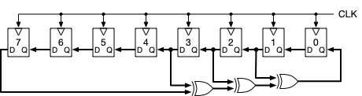
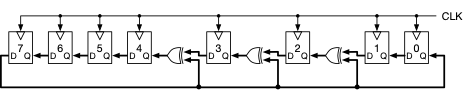
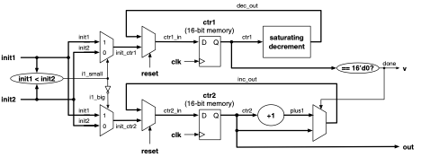
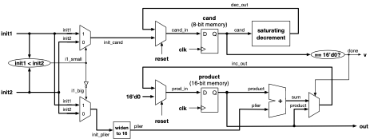
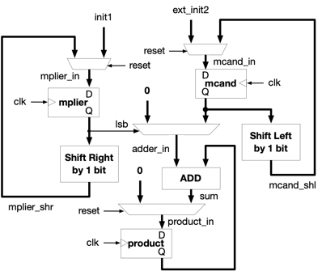

**Designing and Securing Modern Computing Systems**
From Logic Gates to Trusted Kernels

# Project Architecture-2 --- Add a Split Cache

## Purpose: Build Circuits and then Test them to Verify they Work

Now that you have an idea of how to get Verilog running, let's make sure
that your circuits run correctly. This is the task of Validation and
Verification, a process that (among other things) runs a circuit through
its paces to ensure that it behaves correctly. In the following design
projects, you will not only make the circuit, but you will also run a
test to make sure it behaved correctly.

## Hardware Design Steps

Recall the procedure outlined in class for designing hardware:

**Step 1:** Draw a diagram of your design. Iterate on this design many
times, until you are absolutely sure that it is correct. It won't be.
Worry not.

**Step 2:** Label ***all*** of the wires in your design (as well as
latches).

**Step 3:** Translate the diagram to code --- in particular, specify
each wire and give the logic that generates its state or logical value
at any given moment.

**Step 4:** Run your design in your Verilog simulator. Debug it. Fix it.
Go to Step 1.

You're not done until Step 4 gives no errors. :D

## Project L2a: Build a Linear Feedback Shift Register

In this project, you will extend the 8-bit LFSR design that you saw
previously and implement a 16-bit design. If you do it right, it will be
just as simple as the 8-bit design, just a few more lines of code. Here
is the Fibonacci-style 8-bit linear feedback shift register from
earlier:

**Figure: Fibonacci-style LFSR --- 8-bit LFSR with taps at 1, 2, 3, and
7**

    module fib_lfsr8_1237 (
     input           clk,
     input           reset,
       input   [7:0]   reset_val,
       output  [7:0]   fsm_output
    );

        reg     [7:0]   counter;
     assign fsm_output = counter;

        wire    [7:0]   next_val = 

    {
                        counter[6],
                      counter[5],
                      counter[4],
                      counter[3],
                      counter[2],
                      counter[1],
                      counter[0],
                      counter[1] ^ (counter[2] ^ (counter[3] ^ counter[7]))
        

    }

    ;

        always @ (posedge clk) begin
         counter <= (reset) ? reset_val : next_val;
       end

    endmodule

Its output looks like the following, seeded with the value '17' (the
first number that the state machine is started at):

    cycle 0001 - res 1 ctr   0 (00000000)
    cycle 0002 - res 0 ctr  17 (00010001)
    cycle 0003 - res 0 ctr  34 (00100010)
    cycle 0004 - res 0 ctr  69 (01000101)
    cycle 0005 - res 0 ctr 139 (10001011)
    cycle 0006 - res 0 ctr  23 (00010111)
    cycle 0007 - res 0 ctr  46 (00101110)
    cycle 0008 - res 0 ctr  93 (01011101)
    cycle 0009 - res 0 ctr 186 (10111010)
    cycle 0010 - res 0 ctr 117 (01110101)
    cycle 0011 - res 0 ctr 235 (11101011)
    cycle 0012 - res 0 ctr 215 (11010111)
    cycle 0013 - res 0 ctr 175 (10101111)
    cycle 0014 - res 0 ctr  94 (01011110)
    cycle 0015 - res 0 ctr 189 (10111101)
    cycle 0016 - res 0 ctr 123 (01111011)
    cycle 0017 - res 0 ctr 246 (11110110)
    cycle 0018 - res 0 ctr 237 (11101101)
    cycle 0019 - res 0 ctr 219 (11011011)
    cycle 0020 - res 0 ctr 183 (10110111)
    …

Here is the Galois-style 8-bit linear feedback shift register for
comparison:

**Figure: Galois-style LFSR --- 8-bit LFSR with taps at 1, 2, 3, and 7**

    module gal_lfsr8_1237 (
     input           clk,
     input           reset,
       input   [7:0]   reset_val,
       output  [7:0]   fsm_output
    );

        reg     [7:0]   counter;
     assign fsm_output = counter;

        wire    [7:0]   next_val = 

    {
                        counter[6],
                      counter[5],
                      counter[4],
                      counter[3] ^ counter[7],
                     counter[2] ^ counter[7],
                     counter[1] ^ counter[7],
                     counter[0],
                      counter[7]
       

    }

    ;

        always @ (posedge clk) begin
         counter <= (reset) ? reset_val : next_val;
       end

    endmodule

Eight bits is not particularly wide, and so the bit-wise behavior of the
8-bit output trace might not be obvious. Therefore, to make it easier to
see the patterns, the following is the output for a 32-bit LFSR, with 4
taps, at 1, 5, 6, and 31. From the behavior of the output, it should be
reasonably clear why this is called a 'shift register' ... you can see
the shifted patterns quite easily in the output that the Fibonacci
design produces.

    cycle 0001 - res 1 ctr          0 (00000000000000000000000000000000)
    cycle 0002 - res 0 ctr         17 (00000000000000000000000000010001)
    cycle 0003 - res 0 ctr         34 (00000000000000000000000000100010)
    cycle 0004 - res 0 ctr         68 (00000000000000000000000001000100)
    cycle 0005 - res 0 ctr        137 (00000000000000000000000010001001)
    cycle 0006 - res 0 ctr        274 (00000000000000000000000100010010)
    cycle 0007 - res 0 ctr        549 (00000000000000000000001000100101)
    cycle 0008 - res 0 ctr       1099 (00000000000000000000010001001011)
    cycle 0009 - res 0 ctr       2198 (00000000000000000000100010010110)
    cycle 0010 - res 0 ctr       4397 (00000000000000000001000100101101)
    cycle 0011 - res 0 ctr       8795 (00000000000000000010001001011011)
    cycle 0012 - res 0 ctr      17590 (00000000000000000100010010110110)
    cycle 0013 - res 0 ctr      35180 (00000000000000001000100101101100)
    cycle 0014 - res 0 ctr      70360 (00000000000000010001001011011000)
    cycle 0015 - res 0 ctr     140721 (00000000000000100010010110110001)
    cycle 0016 - res 0 ctr     281443 (00000000000001000100101101100011)
    cycle 0017 - res 0 ctr     562887 (00000000000010001001011011000111)
    cycle 0018 - res 0 ctr    1125774 (00000000000100010010110110001110)
    cycle 0019 - res 0 ctr    2251549 (00000000001000100101101100011101)
    cycle 0020 - res 0 ctr    4503098 (00000000010001001011011000111010)
    cycle 0021 - res 0 ctr    9006196 (00000000100010010110110001110100)
    cycle 0022 - res 0 ctr   18012392 (00000001000100101101100011101000)
    cycle 0023 - res 0 ctr   36024784 (00000010001001011011000111010000)
    cycle 0024 - res 0 ctr   72049569 (00000100010010110110001110100001)
    cycle 0025 - res 0 ctr  144099139 (00001000100101101100011101000011)
    cycle 0026 - res 0 ctr  288198278 (00010001001011011000111010000110)
    cycle 0027 - res 0 ctr  576396557 (00100010010110110001110100001101)
    cycle 0028 - res 0 ctr 1152793114 (01000100101101100011101000011010)
    cycle 0029 - res 0 ctr 2305586229 (10001001011011000111010000110101)
    cycle 0030 - res 0 ctr  316205162 (00010010110110001110100001101010)
    cycle 0031 - res 0 ctr  632410325 (00100101101100011101000011010101)
    cycle 0032 - res 0 ctr 1264820651 (01001011011000111010000110101011)
    cycle 0033 - res 0 ctr 2529641302 (10010110110001110100001101010110)
    cycle 0034 - res 0 ctr  764315309 (00101101100011101000011010101101)
    cycle 0035 - res 0 ctr 1528630619 (01011011000111010000110101011011)
    cycle 0036 - res 0 ctr 3057261238 (10110110001110100001101010110110)
    cycle 0037 - res 0 ctr 1819555181 (01101100011101000011010101101101)
    cycle 0038 - res 0 ctr 3639110362 (11011000111010000110101011011010)
    cycle 0039 - res 0 ctr 2983253429 (10110001110100001101010110110101)
    cycle 0040 - res 0 ctr 1671539562 (01100011101000011010101101101010)
    cycle 0041 - res 0 ctr 3343079125 (11000111010000110101011011010101)
    cycle 0042 - res 0 ctr 2391190954 (10001110100001101010110110101010)
    cycle 0043 - res 0 ctr  487414613 (00011101000011010101101101010101)
    cycle 0044 - res 0 ctr  974829227 (00111010000110101011011010101011)
    cycle 0045 - res 0 ctr 1949658454 (01110100001101010110110101010110)
    cycle 0046 - res 0 ctr 3899316908 (11101000011010101101101010101100)
    cycle 0047 - res 0 ctr 3503666520 (11010000110101011011010101011000)
    cycle 0048 - res 0 ctr 2712365744 (10100001101010110110101010110000)
    cycle 0049 - res 0 ctr 1129764192 (01000011010101101101010101100000)
    cycle 0050 - res 0 ctr 2259528384 (10000110101011011010101011000000)
    …

Not very random at all, is it? Why the design behaves this way should be
clear, given the circuit diagrams from before, and the code shown above
... all of the interesting work (the tree of XORs) is only fed into one
place: the very first bit. From there, all of the bits just move down
the bit-vector in a FIFO fashion --- which is the definition of a shift
register. So the initial bit is a random sequence, but those initial
bits just shift down the bit-vector in a very predictable way.

The Galois design behaves differently, because the XOR outputs go into
various places in the bit-vector --- they do not all feed into only one
place. For comparison, the following is the output of the corresponding
Galois design (taps at 1, 5, 6, and 31). The output shown below does not
start at cycle 0, because the beginning is boring and looks just like
the Fibonacci design ... this is the case because nothing interesting
happens in the Galois design unless there is a '1' bit in the
highest-order place (that is the value that is XOR'ed with the other
values, and anything XOR'ed with '0' is just itself). So this region of
output shown below is a relatively interesting region, where you can see
the shift-register behavior, but you can also see that there are places
where the lowest-order bits all become randomized, and the sequences do
not simply shift perfectly down the bit-vector --- they can get changed
as they shift, which happens in the low-order bit positions.

    …

    cycle 0054 - res 0 ctr 3377463296 (11001001010100000000000000000000)
    cycle 0055 - res 0 ctr 2459959493 (10010010101000000000000011000101)
    cycle 0056 - res 0 ctr  624951631 (00100101010000000000000101001111)
    cycle 0057 - res 0 ctr 1249903262 (01001010100000000000001010011110)
    cycle 0058 - res 0 ctr 2499806524 (10010101000000000000010100111100)
    cycle 0059 - res 0 ctr  704645821 (00101010000000000000101010111101)
    cycle 0060 - res 0 ctr 1409291642 (01010100000000000001010101111010)
    cycle 0061 - res 0 ctr 2818583284 (10101000000000000010101011110100)
    cycle 0062 - res 0 ctr 1342199085 (01010000000000000101010100101101)
    cycle 0063 - res 0 ctr 2684398170 (10100000000000001010101001011010)
    cycle 0064 - res 0 ctr 1073828977 (01000000000000010101010001110001)
    cycle 0065 - res 0 ctr 2147657954 (10000000000000101010100011100010)
    cycle 0066 - res 0 ctr     348417 (00000000000001010101000100000001)
    cycle 0067 - res 0 ctr     696834 (00000000000010101010001000000010)
    cycle 0068 - res 0 ctr    1393668 (00000000000101010100010000000100)
    cycle 0069 - res 0 ctr    2787336 (00000000001010101000100000001000)
    cycle 0070 - res 0 ctr    5574672 (00000000010101010001000000010000)
    cycle 0071 - res 0 ctr   11149344 (00000000101010100010000000100000)
    cycle 0072 - res 0 ctr   22298688 (00000001010101000100000001000000)
    cycle 0073 - res 0 ctr   44597376 (00000010101010001000000010000000)
    cycle 0074 - res 0 ctr   89194752 (00000101010100010000000100000000)
    cycle 0075 - res 0 ctr  178389504 (00001010101000100000001000000000)
    cycle 0076 - res 0 ctr  356779008 (00010101010001000000010000000000)
    cycle 0077 - res 0 ctr  713558016 (00101010100010000000100000000000)
    cycle 0078 - res 0 ctr 1427116032 (01010101000100000001000000000000)
    cycle 0079 - res 0 ctr 2854232064 (10101010001000000010000000000000)
    cycle 0080 - res 0 ctr 1413497029 (01010100010000000100000011000101)
    cycle 0081 - res 0 ctr 2826994058 (10101000100000001000000110001010)
    cycle 0082 - res 0 ctr 1359021009 (01010001000000010000001111010001)
    cycle 0083 - res 0 ctr 2718042018 (10100010000000100000011110100010)
    cycle 0084 - res 0 ctr 1141116801 (01000100000001000000111110000001)
    cycle 0085 - res 0 ctr 2282233602 (10001000000010000001111100000010)
    cycle 0086 - res 0 ctr  269500097 (00010000000100000011111011000001)
    cycle 0087 - res 0 ctr  539000194 (00100000001000000111110110000010)
    cycle 0088 - res 0 ctr 1078000388 (01000000010000001111101100000100)
    cycle 0089 - res 0 ctr 2156000776 (10000000100000011111011000001000)
    cycle 0090 - res 0 ctr   17034453 (00000001000000111110110011010101)
    cycle 0091 - res 0 ctr   34068906 (00000010000001111101100110101010)
    cycle 0092 - res 0 ctr   68137812 (00000100000011111011001101010100)
    cycle 0093 - res 0 ctr  136275624 (00001000000111110110011010101000)
    cycle 0094 - res 0 ctr  272551248 (00010000001111101100110101010000)
    cycle 0095 - res 0 ctr  545102496 (00100000011111011001101010100000)
    cycle 0096 - res 0 ctr 1090204992 (01000000111110110011010101000000)
    cycle 0097 - res 0 ctr 2180409984 (10000001111101100110101010000000)
    cycle 0098 - res 0 ctr   65852869 (00000011111011001101010111000101)
    


    …

The randomness happens in those low-order bits because the taps are at
bits 1, 5, and 6. If we have a design with more taps, and which were
more spread out across the bit vector, then our *pseudo-random* sequence
would start to look far more *random-random*.

The following is the output of a Galois design with taps spread out
across the bit-vector, at 1, 5, 11, 14, 17, 19, 23, 26, 29, and 31.

    …

    cycle 0030 - res 0 ctr 1494519877 (01011001000101001001000001000101)
    cycle 0031 - res 0 ctr 2989039754 (10110010001010010010000010001010)
    cycle 0032 - res 0 ctr  759615825 (00101101010001101101000101010001)
    cycle 0033 - res 0 ctr 1519231650 (01011010100011011010001010100010)
    cycle 0034 - res 0 ctr 3038463300 (10110101000110110100010101000100)
    cycle 0035 - res 0 ctr  589437645 (00100011001000100001101011001101)
    cycle 0036 - res 0 ctr 1178875290 (01000110010001000011010110011010)
    cycle 0037 - res 0 ctr 2357750580 (10001100100010000110101100110100)
    cycle 0038 - res 0 ctr 1342457389 (01010000000001000100011000101101)
    cycle 0039 - res 0 ctr 2684914778 (10100000000010001000110001011010)
    cycle 0040 - res 0 ctr  151357681 (00001001000001011000100011110001)
    cycle 0041 - res 0 ctr  302715362 (00010010000010110001000111100010)
    cycle 0042 - res 0 ctr  605430724 (00100100000101100010001111000100)
    cycle 0043 - res 0 ctr 1210861448 (01001000001011000100011110001000)
    cycle 0044 - res 0 ctr 2421722896 (10010000010110001000111100010000)
    cycle 0045 - res 0 ctr 1772457573 (01101001101001011000111001100101)
    cycle 0046 - res 0 ctr 3544915146 (11010011010010110001110011001010)
    cycle 0047 - res 0 ctr 4018317777 (11101111100000101010100111010001)
    cycle 0048 - res 0 ctr 2517746663 (10010110000100011100001111100111)
    cycle 0049 - res 0 ctr 1698109323 (01100101001101110001011110001011)
    cycle 0050 - res 0 ctr 3396218646 (11001010011011100010111100010110)
    cycle 0051 - res 0 ctr 3720924777 (11011101110010001100111001101001)
    cycle 0052 - res 0 ctr 4068805783 (11110010100001010000110010010111)
    cycle 0053 - res 0 ctr 2887682411 (10101100000111101000100101101011)
    cycle 0054 - res 0 ctr  287933075 (00010001001010011000001010010011)
    cycle 0055 - res 0 ctr  575866150 (00100010010100110000010100100110)
    cycle 0056 - res 0 ctr 1151732300 (01000100101001100000101001001100)
    cycle 0057 - res 0 ctr 2303464600 (10001001010011000001010010011000)
    cycle 0058 - res 0 ctr 1535949173 (01011011100011001011100101110101)
    cycle 0059 - res 0 ctr 3071898346 (10110111000110010111001011101010)
    cycle 0060 - res 0 ctr  656831889 (00100111001001100111010110010001)
    cycle 0061 - res 0 ctr 1313663778 (01001110010011001110101100100010)
    cycle 0062 - res 0 ctr 2627327556 (10011100100110011101011001000100)
    cycle 0063 - res 0 ctr 1881619661 (01110000001001110011110011001101)
    cycle 0064 - res 0 ctr 3763239322 (11100000010011100111100110011010)
    cycle 0065 - res 0 ctr 2307416945 (10001001100010000110001101110001)
    cycle 0066 - res 0 ctr 1510233767 (01011010000001000101011010100111)
    cycle 0067 - res 0 ctr 3020467534 (10110100000010001010110101001110)
    cycle 0068 - res 0 ctr  554027737 (00100001000001011100101011011001)
    cycle 0069 - res 0 ctr 1108055474 (01000010000010111001010110110010)
    cycle 0070 - res 0 ctr 2216110948 (10000100000101110010101101100100)
    cycle 0071 - res 0 ctr 1094370957 (01000001001110101100011010001101)
    cycle 0072 - res 0 ctr 2188741914 (10000010011101011000110100011010)
    cycle 0073 - res 0 ctr 1308592753 (01001101111111111000101001110001)
    cycle 0074 - res 0 ctr 2617185506 (10011011111111110001010011100010)
    cycle 0075 - res 0 ctr 2129312129 (01111110111010101011100110000001)
    cycle 0076 - res 0 ctr 4258624258 (11111101110101010111001100000010)
    cycle 0077 - res 0 ctr 2998826561 (10110010101111100111011001000001)
    cycle 0078 - res 0 ctr  745045191 (00101100011010000111110011000111)
    cycle 0079 - res 0 ctr 1490090382 (01011000110100001111100110001110)
    cycle 0080 - res 0 ctr 2980180764 (10110001101000011111001100011100)
    cycle 0081 - res 0 ctr  710375037 (00101010010101110111011001111101)
    cycle 0082 - res 0 ctr 1420750074 (01010100101011101110110011111010)
    cycle 0083 - res 0 ctr 2841500148 (10101001010111011101100111110100)
    cycle 0084 - res 0 ctr  464462765 (00011011101011110010001110101101)
    cycle 0085 - res 0 ctr  928925530 (00110111010111100100011101011010)
    cycle 0086 - res 0 ctr 1857851060 (01101110101111001000111010110100)
    cycle 0087 - res 0 ctr 3715702120 (11011101011110010001110101101000)
    …

I think it should be obvious that this gets much closer to
*random-random* than *pseudo-random*.

Okay, enough of the random-number-appreciation tangent; let's get back
to the project before us. What needs to be done to create a 16-bit LFSR?

- Start with the code for the 8-bit LFSR

- Change the bus widths from 8-bit to 16-bit

- Implement taps at 10, 12, 13, and 15

The following is the skeleton Verilog module given to you to start with,
which shows the interface that the **top.v** test harness expects, plus
the shift-register aspects of the design.

    module random16 (
      input clk,
       input reset,
     input   [15:0] init,
     output  [15:0] out
    );

        reg     [15:0]  counter;
     assign out = counter;

        wire    [15:0]  next_val = 

    {
                        counter[14],
                     counter[13],
                     counter[12],
                     counter[11],
                     counter[10],
                     counter[9],
                      counter[8],
                      counter[7],
                      counter[6],
                      counter[5],
                      counter[4],
                      counter[3],
                      counter[2],
                      counter[1],
                      counter[0],
                      counter[15]
      

    }

    ;

        always @ (posedge clk) begin
         counter <= (reset) ? init : next_val;
        end

    endmodule

Develop the LFSR. You should see output similar to the following, given
an 'init' seed value of '17' and a Fibonacci-style design:

    cycle 0001 - res 1 ctr     0 (0000000000000000)
    cycle 0002 - res 0 ctr    17 (0000000000010001)
    cycle 0003 - res 0 ctr    34 (0000000000100010)
    cycle 0004 - res 0 ctr    68 (0000000001000100)
    cycle 0005 - res 0 ctr   136 (0000000010001000)
    cycle 0006 - res 0 ctr   272 (0000000100010000)
    cycle 0007 - res 0 ctr   544 (0000001000100000)
    cycle 0008 - res 0 ctr  1088 (0000010001000000)
    cycle 0009 - res 0 ctr  2177 (0000100010000001)
    cycle 0010 - res 0 ctr  4354 (0001000100000010)
    cycle 0011 - res 0 ctr  8709 (0010001000000101)
    cycle 0012 - res 0 ctr 17419 (0100010000001011)
    cycle 0013 - res 0 ctr 34839 (1000100000010111)
    cycle 0014 - res 0 ctr  4143 (0001000000101111)
    cycle 0015 - res 0 ctr  8287 (0010000001011111)
    cycle 0016 - res 0 ctr 16575 (0100000010111111)
    cycle 0017 - res 0 ctr 33150 (1000000101111110)
    cycle 0018 - res 0 ctr   765 (0000001011111101)
    cycle 0019 - res 0 ctr  1530 (0000010111111010)
    cycle 0020 - res 0 ctr  3061 (0000101111110101)
    cycle 0021 - res 0 ctr  6122 (0001011111101010)
    cycle 0022 - res 0 ctr 12244 (0010111111010100)
    cycle 0023 - res 0 ctr 24488 (0101111110101000)
    cycle 0024 - res 0 ctr 48976 (1011111101010000)
    cycle 0025 - res 0 ctr 32416 (0111111010100000)
    cycle 0026 - res 0 ctr 64833 (1111110101000001)
    cycle 0027 - res 0 ctr 64130 (1111101010000010)
    cycle 0028 - res 0 ctr 62725 (1111010100000101)
    cycle 0029 - res 0 ctr 59914 (1110101000001010)
    cycle 0030 - res 0 ctr 54292 (1101010000010100)
    …

If you choose instead to implement a Galois-style design, your output
should look something like the following:

    cycle 0001 - res 1 ctr     0 (0000000000000000)
    cycle 0002 - res 0 ctr    17 (0000000000010001)
    cycle 0003 - res 0 ctr    34 (0000000000100010)
    cycle 0004 - res 0 ctr    68 (0000000001000100)
    cycle 0005 - res 0 ctr   136 (0000000010001000)
    cycle 0006 - res 0 ctr   272 (0000000100010000)
    cycle 0007 - res 0 ctr   544 (0000001000100000)
    cycle 0008 - res 0 ctr  1088 (0000010001000000)
    cycle 0009 - res 0 ctr  2176 (0000100010000000)
    cycle 0010 - res 0 ctr  4352 (0001000100000000)
    cycle 0011 - res 0 ctr  8704 (0010001000000000)
    cycle 0012 - res 0 ctr 17408 (0100010000000000)
    cycle 0013 - res 0 ctr 34816 (1000100000000000)
    cycle 0014 - res 0 ctr 30721 (0111100000000001)
    cycle 0015 - res 0 ctr 61442 (1111000000000010)
    cycle 0016 - res 0 ctr 34821 (1000100000000101)
    cycle 0017 - res 0 ctr 30731 (0111100000001011)
    cycle 0018 - res 0 ctr 61462 (1111000000010110)
    cycle 0019 - res 0 ctr 34861 (1000100000101101)
    cycle 0020 - res 0 ctr 30811 (0111100001011011)
    cycle 0021 - res 0 ctr 61622 (1111000010110110)
    cycle 0022 - res 0 ctr 35181 (1000100101101101)
    cycle 0023 - res 0 ctr 31451 (0111101011011011)
    cycle 0024 - res 0 ctr 62902 (1111010110110110)
    cycle 0025 - res 0 ctr 33645 (1000001101101101)
    cycle 0026 - res 0 ctr 28379 (0110111011011011)
    cycle 0027 - res 0 ctr 56758 (1101110110110110)
    cycle 0028 - res 0 ctr 54125 (1101001101101101)
    cycle 0029 - res 0 ctr 52955 (1100111011011011)
    cycle 0030 - res 0 ctr 62903 (1111010110110111)
    cycle 0031 - res 0 ctr 33647 (1000001101101111)
    cycle 0032 - res 0 ctr 28383 (0110111011011111)
    cycle 0033 - res 0 ctr 56766 (1101110110111110)
    cycle 0034 - res 0 ctr 54141 (1101001101111101)
    cycle 0035 - res 0 ctr 52987 (1100111011111011)
    cycle 0036 - res 0 ctr 62967 (1111010111110111)
    cycle 0037 - res 0 ctr 33775 (1000001111101111)
    cycle 0038 - res 0 ctr 28639 (0110111111011111)
    cycle 0039 - res 0 ctr 57278 (1101111110111110)
    cycle 0040 - res 0 ctr 55165 (1101011101111101)
    cycle 0041 - res 0 ctr 50939 (1100011011111011)
    cycle 0042 - res 0 ctr 58871 (1110010111110111)
    cycle 0043 - res 0 ctr 41967 (1010001111101111)
    cycle 0044 - res 0 ctr 12255 (0010111111011111)
    cycle 0045 - res 0 ctr 24510 (0101111110111110)
    cycle 0046 - res 0 ctr 49020 (1011111101111100)
    cycle 0047 - res 0 ctr  5881 (0001011011111001)
    cycle 0048 - res 0 ctr 11762 (0010110111110010)
    cycle 0049 - res 0 ctr 23524 (0101101111100100)
    cycle 0050 - res 0 ctr 47048 (1011011111001000)
    …

See how this looks more random-random than pseudo-random (at least once
you pass the start-up period at around cycle 13 or so)? That is because
it is a Galois design. And, in particular, you see that the randomness
occurs in the high-order bits? That is because the taps are at bit
positions 10, 12, 13, and 15 ... the high-order bits, not the low-order
bits.

In your design directory, there are copies of the 32-bit LFSRs, for
reference, as well as a test script called **test.sh**, which, if you
run it, will build your design and verify that there are no repeating
output values until the **n^th^** output. For a 16-bit
random-number-generator, **n** should be 65,535.

## Project L2b: Build a Sequential Adder

You have built a counter --- you know how to count up by 1, and you know
how to count down by 1. Let's use that to perform an *addition*
operation that adds any two numbers, using only the *count-up-by-1*
function and the *count-down-by-1* function. We will build a circuit
with two counters: one counter counts up by one, and it keeps going
until the other counter counts down to zero. At that point, the first
counter will contain the sum of the two original values. At that point,
we signal 'done' to the outside world, indicating that the sum is ready
to be used.

Note that this is ***not*** how one would normally do addition.

However, this is simple, it uses building blocks that you already know,
and it will work if done correctly.

The following is a circuit diagram:

**Figure: Sequential adder using count-up-by-1 and
saturating-count-down-by-1**

The following is a skeleton Verilog file to start from:

    module satdec (
        input   [15:0]  in,
      output  [15:0]  out
    );
     wire            min = (in == 0);
     wire    [15:0]  minus1 = in - 1;
     assign out = (min) ? in : minus1;
    endmodule

    module add16 (
       input clk,
       input reset,
     input   [15:0]  init1,
       input   [15:0]  init2,
       output          v,
       output  [15:0]  out
    );

        assign v = done;
     assign out = ctr2;

        reg     [15:0]  ctr1, ctr2;
      wire            i1_small =  // your code here
        wire            i1_big =        // your code here
        wire            done =          // your code here
        wire    [15:0]  init_ctr1 = // your code here
        wire    [15:0]  init_ctr2 = // your code here
        wire    [15:0]  ctr1_in =       // your code here
        wire    [15:0]  ctr2_in =       // your code here
        wire    [15:0]  plus1 =     // your code here
        wire    [15:0]  inc_out =       // your code here
        wire    [15:0]  dec_out;

        satdec mydec                    // your code here

        always @ (posedge clk) begin
         ctr1 <= ctr1_in;
         ctr2 <= ctr2_in;
     end

    endmodule

You might wonder what those MUXes at the beginning are doing? They are
putting the smaller of the two values into **ctr1**, and the larger of
the two into **ctr2**, so that we minimize the amount of time it takes
to come to an answer.

In the design directory there is an Output file, which is the output of
my solution. Save your output to a file and do a **diff** between the
two. There should be no difference (in the part that matters).

## Project L2c: Build a Sequential Multiplier

In this project, we will build an 8-bit sequential multiplier, in a very
rudimentary fashion. This will look a whole lot like the sequential
adder that you just built.

We will implement multiplication as it is defined mathematically.
Multiplication is the product of two *factors*, a *multiplicand*, and a
*multiplier*. By definition, to produce the product, the *multiplicand*
is added to itself the number of times indicated by the *multiplier*.

    multiplicand = 4
    multiplier = 3

    3 x 4 = 4 + 4 + 4 = 12

As one might imagine, the hardware design for this is very slow, as it
iteratively adds one number to itself, over and over, and it takes as
many clock cycles as the multiplier's value. So it is definitely not to
be used for 32-bit numbers. Real multiply units are not made this way.
However, this design is very simple, it is (hopefully) intuitive, it
produces correct output, and so it should be a good introduction to
state-machine design.

The following is a circuit diagram:

**Figure: Sequential multiplier**

The following is a skeleton Verilog file to start from:

    module satdec (
        input   [7:0]   in,
      output  [7:0]   out
    );
     wire            min = (in == 0);
     wire    [7:0]   minus1 = in - 1;
     assign out = (min) ? in : minus1;
    endmodule

    module mul8 (
        input clk,
       input reset,
     input   [7:0]   init1,
       input   [7:0]   init2,
       output          v,
       output  [15:0]  out
    );

        assign  v = done;
        assign  out = product;

        reg     [7:0]   cand;
        reg     [15:0]  product;
     wire            i1_small =  // your code here
        wire            i1_big =        // your code here
        wire            done =          // your code here
        wire    [7:0]   init_cand = // your code here
        wire    [7:0]   init_plier =    // your code here
        wire    [15:0]  plier =     

    {

    8'd0, init_plier

    }

    ;
        wire    [7:0]   cand_in =       // your code here
        wire    [15:0]  prod_in =       // your code here
        wire    [15:0]  sum =           // your code here
        wire    [15:0]  inc_out =       // your code here
        wire    [7:0]   dec_out;

        satdec mydec                    // your code here

        always @ (posedge clk) begin
         cand <= cand_in;
         product <= prod_in;
      end

    endmodule

Develop the multiplier. You should see output similar to the following,
an example output when the **top.v** module uses the values 5 and 9 as
inputs:

    cycle 0001 - res 1 v 1 mul 0
    cycle 0002 - res 0 v 0 mul 0
    cycle 0003 - res 0 v 0 mul 9
    cycle 0004 - res 0 v 0 mul 18
    cycle 0005 - res 0 v 0 mul 27
    cycle 0006 - res 0 v 0 mul 36
    cycle 0007 - res 0 v 1 mul 45
    cycle 0008 - res 0 v 1 mul 45
    cycle 0009 - res 0 v 1 mul 45
    cycle 0010 - res 0 v 1 mul 45
    cycle 0011 - res 0 v 1 mul 45
    cycle 0012 - res 0 v 1 mul 45
    …

As you see, it adds 9 to itself 5 times. Thanks to your saturating
count-down design from the previous project, the output value should
remain stable once it reaches the desired value at the same time that
the count-down timer (holding the multiplier) reaches zero.

Here is the output when we simply reverse the 9 and 5 values and do not
have those MUXes at the front, which choose the smaller/larger values
and set them to ***cand*** and ***product***, respectively:

    cycle 0001 - res 1 v 1 mul 0
    cycle 0002 - res 0 v 0 mul 0
    cycle 0003 - res 0 v 0 mul 5
    cycle 0004 - res 0 v 0 mul 10
    cycle 0005 - res 0 v 0 mul 15
    cycle 0006 - res 0 v 0 mul 20
    cycle 0007 - res 0 v 0 mul 25
    cycle 0008 - res 0 v 0 mul 30
    cycle 0009 - res 0 v 0 mul 35
    cycle 0010 - res 0 v 0 mul 40
    cycle 0011 - res 0 v 1 mul 45
    cycle 0012 - res 0 v 1 mul 45
    cycle 0013 - res 0 v 1 mul 45
    cycle 0014 - res 0 v 1 mul 45
    cycle 0015 - res 0 v 1 mul 45
    …

This time, it adds 5 to itself 9 times. It reaches the same result as
before, but it takes roughly twice as long. The MUXes at the front avoid
that.

One thing to make sure when you are implementing your design --- make
sure you consider corner cases, because this design has an important
one. In particular, if the multiplier has the value 0, you should not
add the multiplicand to itself at all. The following illustrates:

    cycle 0001 - res 1 v 1 mul 0
    cycle 0002 - res 0 v 1 mul 0
    cycle 0003 - res 0 v 1 mul 0
    cycle 0004 - res 0 v 1 mul 0
    cycle 0005 - res 0 v 1 mul 0
    cycle 0006 - res 0 v 1 mul 0

Here, the multiplier was set to zero, so the output should be zero. Note
that the output starts at zero, and so the output is valid as soon as
the circuit begins. This explains why, for all of the examples, the
validity signal 'v' always starts out as '1' and then becomes '0' during
the computation: the 'product' register, which is tied to the output,
should be initialized to zero and not to the multiplier. If it starts at
a non-zero value, then the output will be non-zero when the multiplicand
is zero, and that would be a bug.

In the design directory there is an Output file, which is the output of
my solution. Save your output to a file and do a **diff** between the
two. There should be no difference (in the part that matters).

**Project L2d: Build a *Better* Sequential Multiplier**

For extra credit, try making a multiplier that behaves better than the
one in Project L2c. That one will take a *long* time to arrive at the
answer if you use large numbers. Here is something that more closely
resembles reality:

**Figure: Sequential multiplier**

The following is a skeleton Verilog file to start from:

    module mul8 (
      input clk,
       input reset,
     input   [7:0]   init1,
       input   [7:0]   init2,
       output          v,
       output  [15:0]  out
    );

        assign  v = done;
        assign  out = product;

        reg     [7:0]   mplier;
      reg     [15:0]  mcand;
       reg     [15:0]  product;

        wire    [15:0]  ext_init2 =     

    {

    8'd0, init2

    }

    ;

        wire            done =          (mplier == 0);
       wire            lsb =           // your code here

        wire    [7:0]   mplier_shr =    // your code here
        wire    [15:0]  mcand_shl =     // your code here

        wire    [15:0]  adder_in =      // your code here
        wire    [15:0]  sum =           // your code here
        wire    [7:0]   mplier_in =     // your code here
        wire    [15:0]  mcand_in =      // your code here
        wire    [15:0]  product_in =    // your code here

        always @ (posedge clk) begin
         mcand <= mcand_in;
           product <= product_in;
           mplier <= mplier_in;
     end

    endmodule
